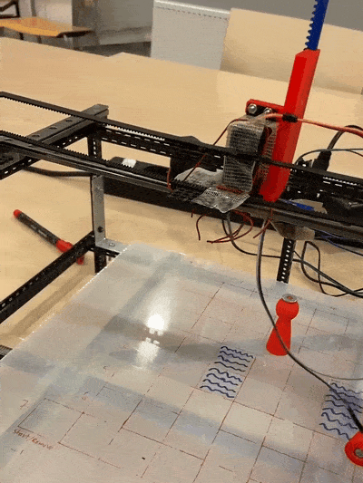
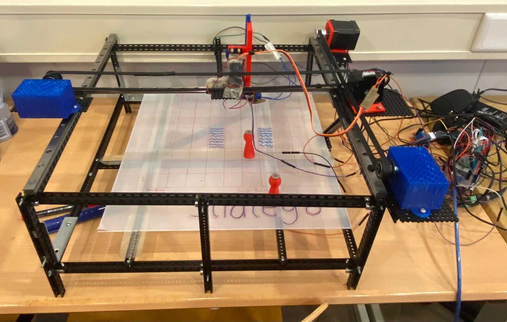
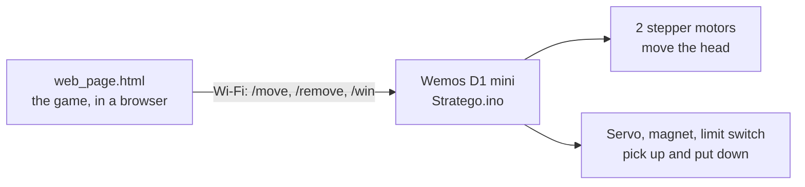

# Robotic Stratego Board

A Stratego board that moves its own pieces. Two players play in a web page, and after every move a Wemos D1 mini drives a belt gantry and an electromagnet to pick the piece up and put it on its new square. It's a smaller version of Stratego: an 8×8 board with 10 pieces per player.

Made for the New Devices Lab course at Radboud University (2023), together with Robert van der Maas.

  
   
  Picking up a piece and moving it one square (3× speed)

A longer demo video is in [`Stratego_board_demo.mp4`](Stratego_board_demo.mp4).

## How it works

`web_page.html` runs the game: setup, legal moves, fights and the win check. For every move it sends an HTTP request to the Wemos, which drives the head to the square, lowers the magnet onto the steel washer on top of the pawn, lifts it and sets it down on its new square. The Wemos only replies when it's done, so the page waits before the next turn.

## Parts

- Wemos D1 mini (ESP8266)
- 2 NEMA 17 stepper motors with A4988-style drivers, on GT2 belts
- MG995 continuous-rotation servo with a 3D-printed rack and pinion
- Electromagnet (switched by a relay) and a limit switch
- Pawns with a steel washer on top
- Slotted steel angle frame and 3D-printed parts

Pin assignments are at the top of `Stratego/Stratego.ino`.

## Running it

1. In the Arduino IDE, install the **esp8266** boards package, open `Stratego/Stratego.ino`, set your Wi-Fi `ssid` and `password`, and upload it to a **LOLIN(WEMOS) D1 R2 & mini**.
2. Open the Serial Monitor at 115200 baud, note the board's IP address, and put it in `web_page.html` in place of `192.168.1.106` (it appears three times).
3. Put the head on the *Start/Remove* square next to the board (there's no homing), power the motors, and open `web_page.html` in a browser on the same network.

## My role

This was a two-person project with Robert van der Maas. I worked on the mechanics and 3D-printed parts, the electronics and wiring, and the Wemos firmware (`Stratego/Stratego.ino`). Robert wrote most of the web page (`web_page.html`), and I improved its structure and game logic.
